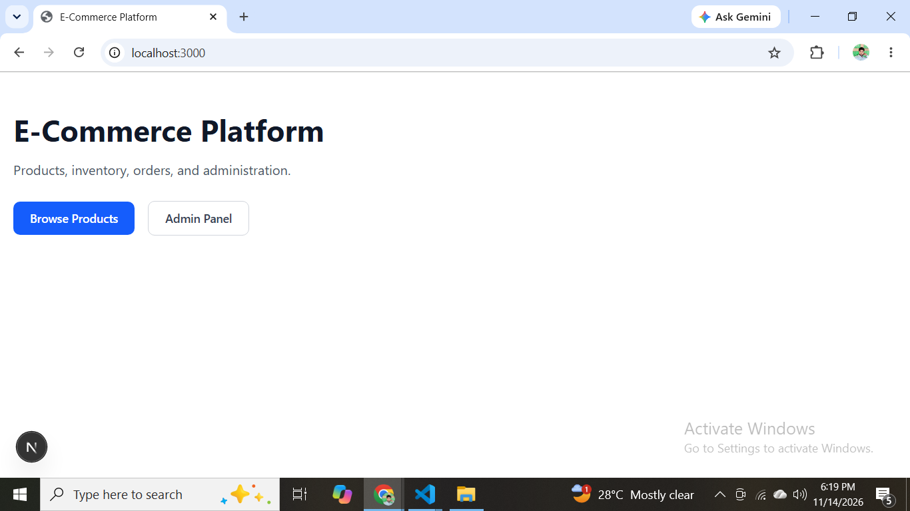
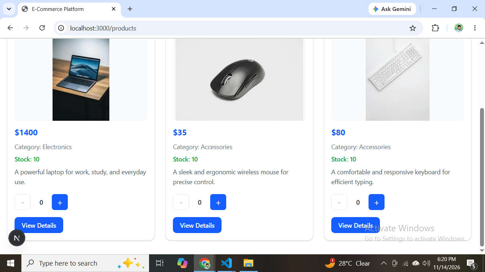
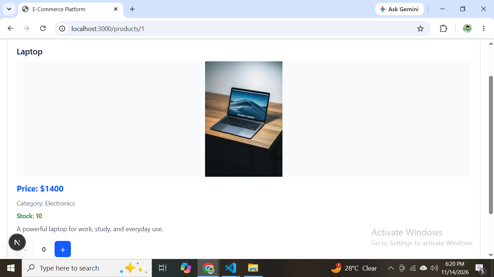
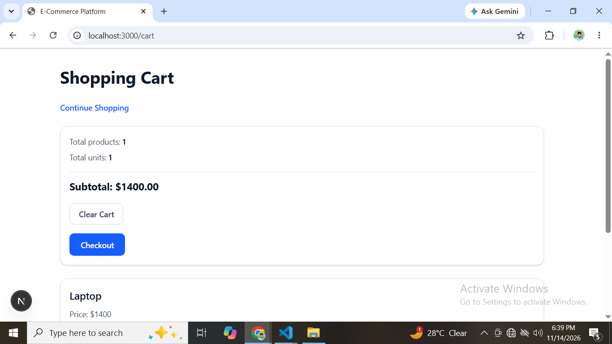
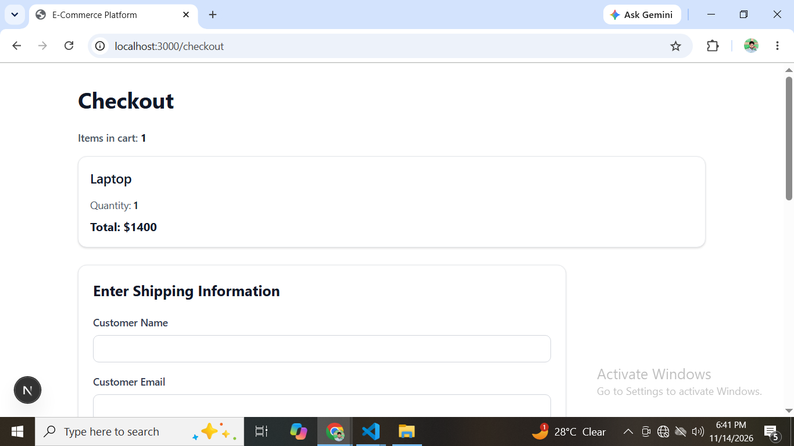
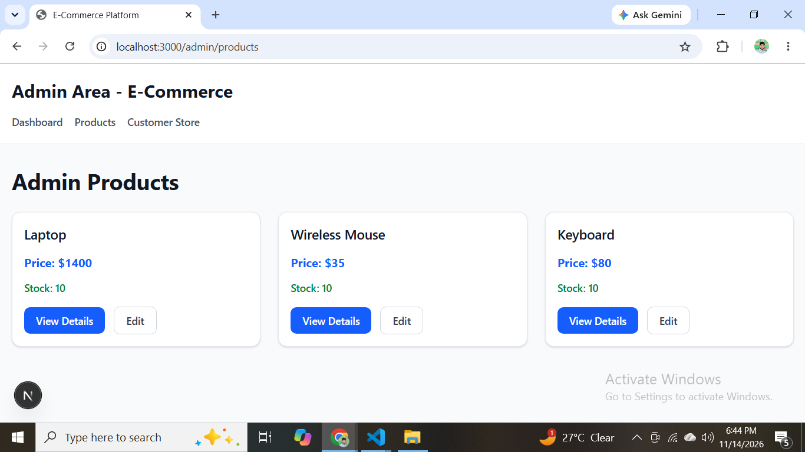
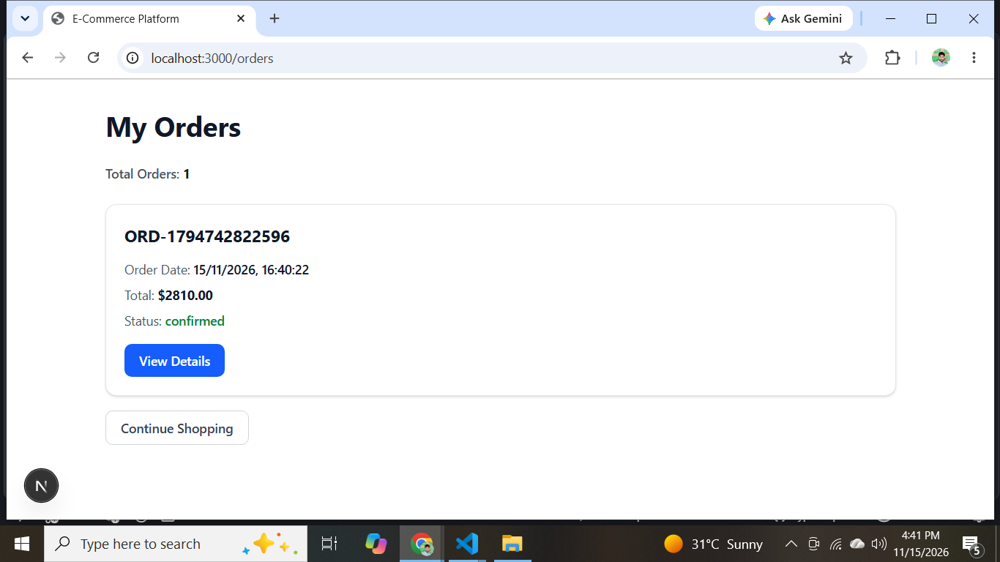

# E-Commerce Platform

A frontend e-commerce and inventory management application built with **Next.js, React, and TypeScript**. The project demonstrates customer shopping workflows, cart management, checkout, order processing, and product inventory administration.

## Screenshots

### Home Page



### Products



### Product Details



### Shopping Cart



### Checkout



### Admin Products



### Orders



## Technologies Used

- Next.js 16 (App Router)
- React
- TypeScript
- Tailwind CSS
- React Context API
- React `useReducer` and `useState`
- Next.js Link and dynamic routing

## Features

### Customer Store

- Browse available products.
- View individual product details.
- Add products to the shopping cart.
- Increase or decrease product quantities.
- Check product availability and stock limits.
- View and manage cart items.

### Cart and Checkout

- Shared cart state across application routes.
- Validate product availability before checkout.
- Prevent checkout when the cart is empty or contains invalid quantities.
- Shipping information form with validation.
- Billing information form with validation.
- Review order details before confirmation.

### Order Management

- Confirm customer orders.
- Generate unique order IDs and order numbers.
- Display order information and order status.
- View individual order details.
- Display shipping and billing information.
- Cancel eligible orders.
- Restore inventory quantities when an order is cancelled.

### Inventory Management

- Admin product listing.
- Individual product details.
- Edit product information.
- Update product prices and stock quantities.
- Synchronize cart availability with inventory changes.
- Validate product information before updates.

### State Management and Data Integrity

- React Context API for shared application state.
- useReducer for coordinated order confirmation, cancellation, and inventory updates.
- Validate stock availability before order confirmation.
- Update orders and inventory together during confirmation and cancellation.
- Preserve historical product names and prices in order item snapshots.
- Prevent repeated cancellation from restoring stock more than once.

## Application Routes

| Route                       | Description                  |
| --------------------------- | ---------------------------- |
| `/`                         | Home page                    |
| `/products`                 | Customer product listing     |
| `/products/[id]`            | Product details              |
| `/cart`                     | Shopping cart                |
| `/checkout`                 | Checkout process             |
| `/orders`                   | Customer orders              |
| `/orders/[id]`              | Individual order details     |
| `/admin`                    | Admin dashboard landing page |
| `/admin/products`           | Admin product listing        |
| `/admin/products/[id]`      | Admin product details        |
| `/admin/products/[id]/edit` | Edit product information     |

## Getting Started

### Prerequisites

- Node.js
- npm

### Installation

Clone the repository:

```bash
git clone YOUR_REPOSITORY_URL
```

Navigate into the project directory:

```bash
cd ecommerce-platform
```

Install dependencies:

```bash
npm install
```

Start the development server:

```bash
npm run dev
```

Open the application:

```text
http://localhost:3000
```

### Production Build

To create a production build:

```bash
npm run build
```

To start the production server after building:

```bash
npm start
```

## Current Project Limitations

This is the frontend phase of the project.

- Product information currently comes from mock data.
- Cart, inventory, and order state are managed in React Context.
- Application state is not persisted to a database.
- Refreshing the browser resets in-memory application data.
- Authentication and authorization are not implemented yet.
- Database-driven search and filtering are planned for the backend integration phase.
- Payment processing is not integrated.
- The admin interface is currently a frontend demo and is not protected by authentication or role-based access control.

## Future Development

The next development phase will focus on:

- Building the backend using NestJS.
- Database integration and persistent storage.
- REST API development.
- User authentication and authorization.
- Database-driven product search, filtering, sorting, and pagination.
- Persistent cart and order management.
- Backend validation and security.

## Project Purpose

This project is part of my full-stack web development learning journey. Its purpose is to practice building structured React applications, managing shared state, implementing data-integrity rules, handling customer and admin workflows, and understanding application architecture.

The backend and database integration will be added in a future development phase.
